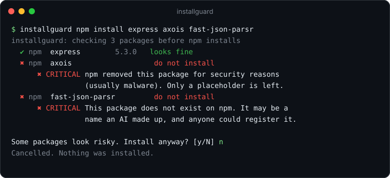

<div align="center">

# 🛡️ installguard

**Check packages, and everything they pull in, before you install them.**

Catches fake, typosquatted, hijacked and AI-hallucinated packages on **npm** and **PyPI** before any of their code runs on your machine.

[](https://github.com/iambazzy/installguard/actions/workflows/ci.yml)
[](https://www.npmjs.com/package/installguard-cli)
[](package.json)
[](LICENSE)
[](https://buymeacoffee.com/iambazzy)



</div>

---

## Why

AI coding assistants sometimes suggest packages **that don't exist**. Attackers watch for those names, register them and fill them with malware. This is called *slopsquatting*. Add typo tricks (`reqeusts`, `axois`, `lodahs`) and hijacked releases of real packages, and a single `npm install` or `pip install` is enough to get compromised.

Package managers install whatever you ask for, plus everything it depends on. **installguard looks first.** Before anything is installed, it works out the full list of packages the install would add, using a dry run that never runs package code, and checks every one of them:

- Does the package exist? Was it pulled from the registry for being malware?
- Is its name one or two letters away from a popular package?
- Was it first published days ago, with almost no downloads?
- Does it run a script during install, and does that script download or execute code?
- Was this release published by someone who has never published the package before?
- Is the release deprecated, yanked, or younger than your team's minimum age?

If everything looks normal, your install runs as usual. If not, you see why and decide.

## Install

```sh
npm install -g installguard-cli
```

The package is called `installguard-cli`; the command it installs is `installguard`.

Requires Node.js 18.17 or newer, on macOS, Linux or Windows. **installguard has zero dependencies**, because a security tool shouldn't add to your supply chain.

## Use

Put `installguard` in front of any install command:

```sh
installguard npm install express
installguard pip install requests==2.32.3
installguard pnpm add zod
installguard npm ci
```

Works with **npm, pnpm, yarn, bun, pip, `python -m pip`, uv, poetry, pipx and pipenv**, both for adding packages (`npm install x`, `pip install x`) and for installing from a lockfile (`npm ci`, `yarn`, `pnpm install`, `poetry install`, `uv sync`, `pipenv install`). Anything that isn't an install (`npm run build`, `pip list`) passes straight through.

### Make it automatic

Add these to your `~/.bashrc` or `~/.zshrc` and you never have to think about it:

```sh
alias npm='installguard npm'
alias pnpm='installguard pnpm'
alias yarn='installguard yarn'
alias pip='installguard pip'
```

### Check without installing

```sh
installguard check express lodash          # npm (default)
installguard check --pypi numpy pandas     # PyPI
installguard check npm:axios pypi:requests # mix both
installguard scan "cd app && npm i axois && pip install reqeusts"
```

### Audit a project

```sh
installguard audit .
```

Checks every package in your lockfiles (`package-lock.json`, `yarn.lock`, `pnpm-lock.yaml`, `bun.lock`, `poetry.lock`, `uv.lock`, `Pipfile.lock`), including deep dependencies. Without a lockfile it falls back to `package.json` and `requirements*.txt`. Exits with code `1` if anything is risky, so it drops straight into CI.

## Protect your AI coding agent

Agents install packages without reading the warnings. installguard can **block** a risky install *before* the agent runs it, and tell the agent why, so it can fix the name itself.

Point any agent that supports pre-command hooks at `installguard hook`. For agents configured with a JSON hooks file, the setup usually looks like this:

```json
{
  "hooks": {
    "PreToolUse": [
      {
        "matcher": "Bash",
        "hooks": [{ "type": "command", "command": "installguard hook" }]
      }
    ]
  }
}
```

**Any other tool:** pipe the command to `installguard hook`. It accepts JSON (`{"tool_input": {"command": "..."}}` or `{"command": "..."}`) or plain text, exits `0` to allow and `2` to block, with the reason on stderr.

## GitHub Action

Fail a pull request when it adds a risky dependency anywhere in the tree:

```yaml
# .github/workflows/deps.yml
name: Dependency check
on: [pull_request]
jobs:
  installguard:
    runs-on: ubuntu-latest
    steps:
      - uses: actions/checkout@v5
      - uses: iambazzy/installguard@v1.0.0
        with:
          path: .          # folder with your lockfile or manifests
          strict: false    # true = also fail on "check this" findings
```

## What it checks

| Check | Severity | Why it matters |
|---|---|---|
| Package doesn't exist | 🔴 critical | Hallucinated names are free for attackers to register |
| npm security placeholder | 🔴 critical | npm removed it, usually for malware |
| Name looks like a popular package | 🟠 high | Typosquatting (`axois` → `axios`), checked against the 9,000 most-downloaded packages |
| First published under 7 days ago | 🟠 high | Most malicious packages are brand new |
| Install script that downloads or runs code | 🟠 high | `curl … \| sh` in `postinstall` is a classic payload |
| Requested version doesn't exist | 🟠 high | Often a hallucinated version number |
| Version was yanked | 🟠 high | Authors pulled it for a reason |
| Release younger than your minimum age | 🟠 high | Only if you set `minReleaseAgeDays` (see below) |
| Published under 30 days ago | 🟡 medium | Worth a second look |
| Under 100 downloads last week | 🟡 medium | Nobody else is using it |
| Any install script on a little-used package | 🟡 medium | Code runs on your machine at install time |
| New publisher on a fresh release | 🟡 medium | What an account takeover looks like |
| Deprecated | 🟡 medium | Often has known vulnerabilities, or a better replacement |
| No source repository, single version, fresh release | ⚪ low | Context, never blocks |

**Verdicts:** 🔴 and 🟠 stop the install and ask you first. 🟡 is shown but doesn't stop the install unless you use `--strict`. In CI and agent hooks, where there's no one to ask, risky installs are blocked.

To keep the signal clean, installguard is deliberately quiet about well-known packages: maintainer changes and unusual install scripts on widely used packages are only flagged when the release is brand new, and verified CI publishing (npm trusted publishing) is never treated as a takeover. Tested against nearly 900 legitimate npm and PyPI packages, fewer than 1% got a blocking warning.

## Options

```
-y, --yes       continue without asking, even if something looks risky
--strict        also stop on medium ("check this") findings
--direct        only check the packages you name, not their dependencies
--dry-run       check only, never run the install
--json          machine-readable results on stdout
-v, --verbose   show every finding and every package checked
```

**Exit codes:** `0` ok · `1` stopped because of a risky package · `2` error

### Config

Create `.installguardrc.json` in your project (or home folder):

```json
{
  "allow": ["my-company-internal-lib"],
  "strict": false,
  "minReleaseAgeDays": 0
}
```

- **`allow`**: packages you trust that would otherwise be flagged, such as private packages. You can also set `INSTALLGUARD_ALLOW=pkg-a,pkg-b`.
- **`strict`**: treat medium findings as blocking.
- **`minReleaseAgeDays`**: block any release younger than this many days, including releases pulled in as dependencies. Hijacked releases are usually caught and removed within a day or two, so `2` is a good value for teams.

### Cache

Registry lookups are cached so repeat installs are instant (about 2 seconds for an 800-package lockfile). The cache lives in your platform's cache folder: `installguard cache` prints the path and `installguard cache clear` empties it. Set `INSTALLGUARD_NO_CACHE=1` to turn it off.

## How it works

1. **Parse** the install command and work out which package manager and packages are involved.
2. **Preview the full install** without running any package code: `npm install --package-lock-only --ignore-scripts` in a temporary copy of your project, `pip install --dry-run --report` limited to pre-built wheels, or `uv pip install --dry-run`. For lockfile installs, it reads the lockfile.
3. **Check every new package** against the npm registry, npm's download counts, and PyPI's JSON API. Popular packages are checked through small per-version endpoints, so even huge packages like `typescript` take milliseconds.
4. **Decide**: let the install run, ask you, or block it.

It never installs or executes a package itself. If a registry can't be reached, it says so and doesn't guess.

## Limitations

installguard is a strong safety net, not a guarantee. It's worth knowing what it can't see:

- **It checks metadata, not code.** It looks at names, ages, publishers, download counts and install scripts, not at what the package's code does. A trusted package that's hijacked and published by its usual maintainer, with no install script, may only show up as a fresh release. Set `minReleaseAgeDays` to cover that case.
- **Python source-only packages.** To avoid running their setup code, pip is only asked to preview pre-built wheels. If a package in the tree only ships as source, installguard checks the packages you named and tells you the rest of the tree couldn't be previewed.
- **pnpm, yarn and bun installs are previewed with npm's resolver**, so the dependency tree can differ slightly from what those tools pick. Running `installguard audit` afterwards checks the exact lockfile.
- **PyPI download counts** come from pypistats.org, which sometimes blocks automated requests. installguard then skips that one signal; every other PyPI check still runs.
- **Private registries:** packages that only exist on a private registry will be reported as missing from the public registry. Add them to `allow`.

## Contributing

Ideas and PRs are welcome. See [CONTRIBUTING.md](CONTRIBUTING.md). The popular-package lists are rebuilt with `npm run update-popular`.

## Support this project

installguard is free and open source, built and maintained by [@iambazzy](https://github.com/iambazzy). If it caught something for you, or your team relies on it, please consider supporting it:

<a href="https://buymeacoffee.com/iambazzy"></a>

**Companies:** sponsorship includes your logo here and priority on issues. [Get in touch](mailto:mohammadbasit0404@gmail.com).

A ⭐ on the repo helps more people find it.

## License

[MIT](LICENSE) © Mohammad Basit
